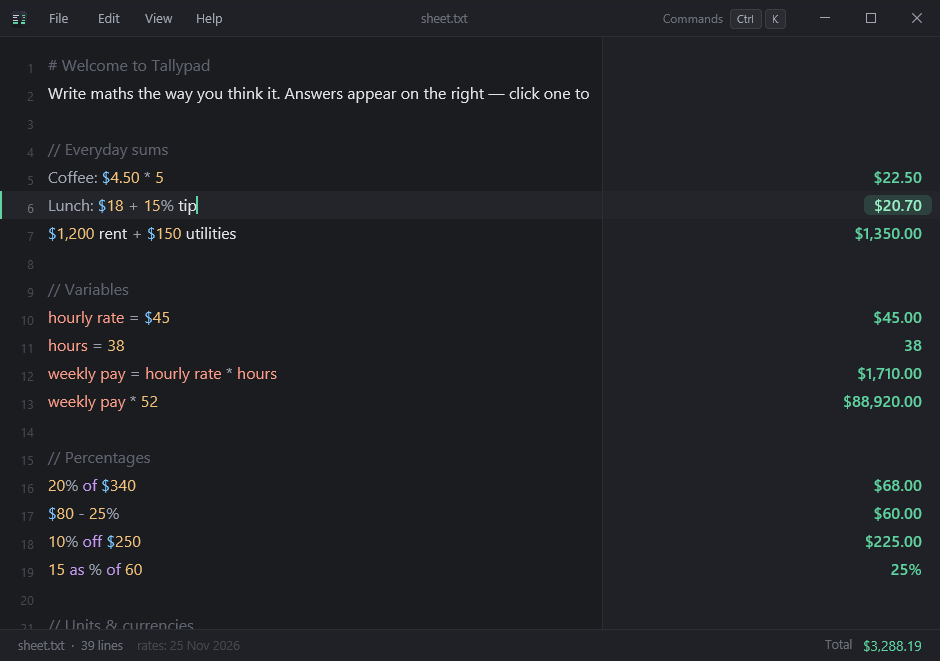
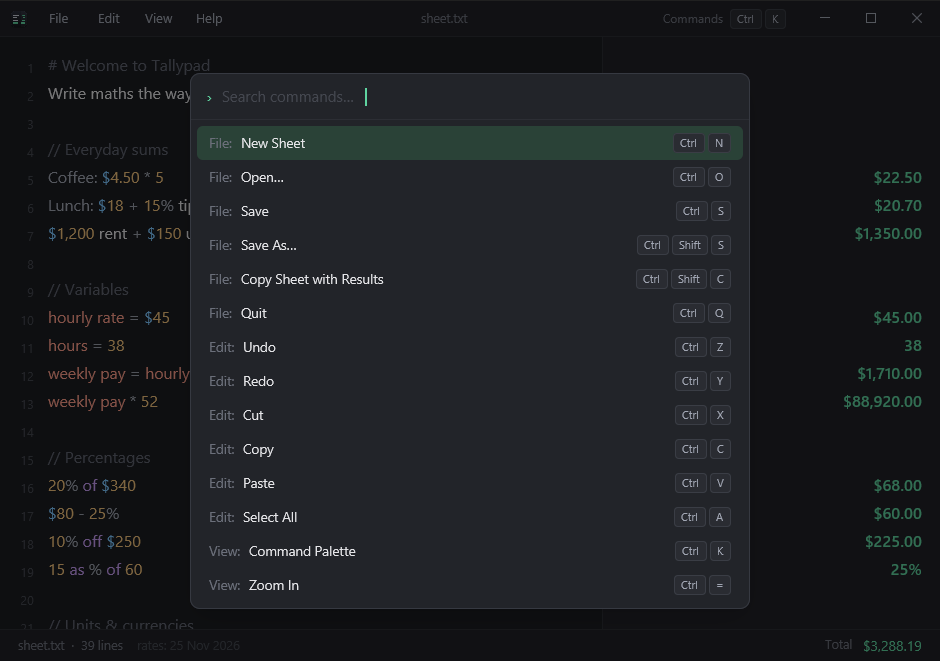
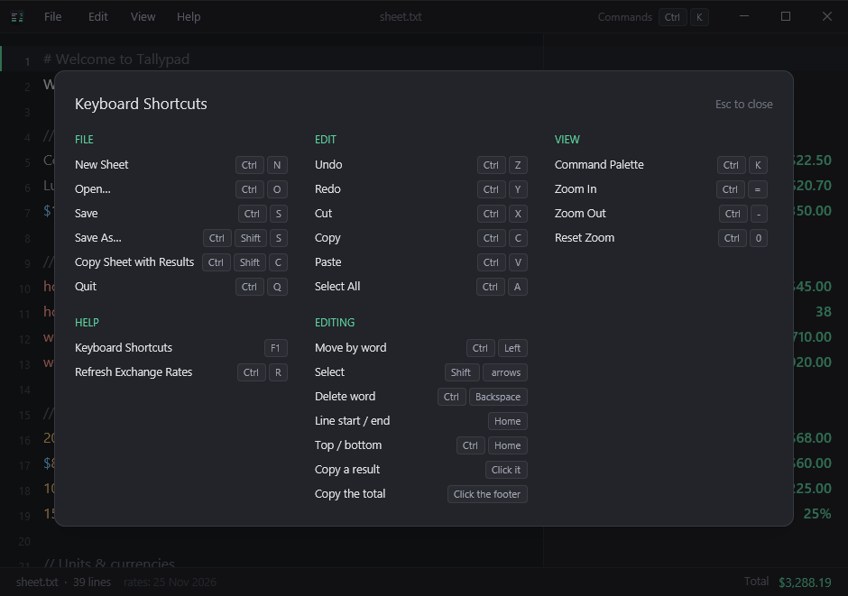

<p align="center">
  
</p>

<h1 align="center">Tallypad</h1>

<p align="center">
  A notepad calculator for Windows. Type maths in plain text and see the answers as you type.<br>
  <strong>Inspired by <a href="https://soulver.app">Soulver</a></strong>, built with Rust and <a href="https://gpui.rs">GPUI</a>.
</p>

<p align="center">
  <a href="https://github.com/aimen08/tallypad/releases/latest/download/Tallypad.exe"><b>Download for Windows</b></a> ·
  <a href="https://aimen08.github.io/tallypad/">Website</a> ·
  <a href="https://github.com/aimen08/tallypad/releases">Releases</a>
</p>

<p align="center">
  <a href="https://github.com/aimen08/tallypad/actions/workflows/ci.yml"></a>
  <a href="https://github.com/aimen08/tallypad/releases/latest"></a>
  
  
  
  <a href="LICENSE"></a>
</p>



> **Inspired by Soulver.** [Soulver](https://soulver.app) is a great notepad calculator for Mac and iPhone. Tallypad is an independent open-source project that brings the same idea to Windows. It isn't affiliated with or endorsed by Soulver's makers.

## Native Rust, small footprint

Tallypad is written entirely in **Rust**. It renders on the GPU with [GPUI](https://gpui.rs), the framework behind the Zed editor. There's no Electron, no web view and no runtime to install.

| | Tallypad 0.1.0 |
|---|---|
| Memory at idle | **~66 MB** working set |
| Download | **one 9.6 MB `.exe`**, no installer |
| Startup | opens instantly; rates and updates load in the background |

<sub>Measured on Windows 11 with the release build and the welcome sheet open, after 15 seconds idle: working set 66 MB, private bytes 83 MB.</sub>

## Features

| | Examples |
|---|---|
| **Plain-text maths** | `Lunch: $18 + 15% tip` · `$20 for taxi + $9 for coffee` · `// comments` · `# headings` |
| **Variables** | `hourly rate = $45` then `hourly rate * 38` (names can be several words; type `hou` and press <kbd>Tab</kbd> to autocomplete) |
| **References** | `sum`, `total`, `average` of the lines above · `prev` · `line 3` |
| **Percentages** | `20% of $340` · `$80 - 25%` · `10% off $250` · `5% on 200` · `15 as % of 60` |
| **Units** | `5 km in miles` · `72 °F to °C` · `60 km/h * 45 min` · `3 m * 4 m` · `2 GB in MB` |
| **Live currencies** | `€250 in USD` · `$25/h * 8 h` · 35+ currencies with live rates, cached for offline use |
| **Functions** | `sqrt`, `cbrt`, `abs`, `round`, `floor`, `ceil`, `sin`/`cos`/`tan` (with `deg`), `log`, `ln`, `exp`, `5!` |
| **Number formats** | `5k`, `2M`, `1,500`, `0xFF` · `255 in hex` / `binary` / `octal` / `sci` |

It also has:

- A **command palette** (<kbd>Ctrl</kbd>+<kbd>K</kbd>) with fuzzy search over every command.
- A **custom title bar** with File / Edit / View / Help menus. Windows still handles window snapping and Snap Layouts.
- A **current-line highlight** that runs across both columns and slides when you move between lines, so it's clear which answer belongs to the line you're on.
- **Click any answer to copy it.** Click the footer total to copy the total.
- **Self-updating.** When a new release is out, an *Update* pill appears in the footer. One click downloads it and restarts the app.
- **Variable autocomplete.** Start typing a variable's name and a popup suggests matching variables with their values. <kbd>Tab</kbd> or <kbd>Enter</kbd> inserts one, <kbd>↑</kbd>/<kbd>↓</kbd> pick, <kbd>Esc</kbd> closes.
- **Autosave.** Your sheet is saved as you type (the default one lives in `%APPDATA%\Tallypad\sheet.txt`). Tallypad reopens the last sheet you had open, with the cursor where you left it.

<p>
  
  
</p>

## Keyboard shortcuts

| Action | Keys |
|---|---|
| Command palette | <kbd>Ctrl</kbd>+<kbd>K</kbd> (or <kbd>Ctrl</kbd>+<kbd>Shift</kbd>+<kbd>P</kbd>) |
| New / Open / Save / Save as | <kbd>Ctrl</kbd>+<kbd>N</kbd> · <kbd>Ctrl</kbd>+<kbd>O</kbd> · <kbd>Ctrl</kbd>+<kbd>S</kbd> · <kbd>Ctrl</kbd>+<kbd>Shift</kbd>+<kbd>S</kbd> |
| Copy sheet with results | <kbd>Ctrl</kbd>+<kbd>Shift</kbd>+<kbd>C</kbd> |
| Undo / Redo | <kbd>Ctrl</kbd>+<kbd>Z</kbd> · <kbd>Ctrl</kbd>+<kbd>Y</kbd> |
| Zoom in / out / reset | <kbd>Ctrl</kbd>+<kbd>=</kbd> · <kbd>Ctrl</kbd>+<kbd>-</kbd> · <kbd>Ctrl</kbd>+<kbd>0</kbd> |
| Refresh exchange rates | <kbd>Ctrl</kbd>+<kbd>R</kbd> |
| All shortcuts | <kbd>F1</kbd> |

## Install

Download [`Tallypad.exe`](https://github.com/aimen08/tallypad/releases/latest/download/Tallypad.exe) and run it. There's no installer. The binary isn't code-signed yet, so the first time you run it SmartScreen may ask you to confirm (*More info → Run anyway*).

## Build from source

Requires Rust (stable) and the MSVC build tools.

```powershell
git clone https://github.com/aimen08/tallypad
cd tallypad
cargo run --release
```

> If your checkout lives in a very deep folder, set `CARGO_TARGET_DIR` to a short path (e.g. `C:\t`) to avoid Windows path-length limits.

Run the tests with `cargo test`. To regenerate the icon, run `python assets/make_icon.py` (needs Pillow).

## Releasing

1. Bump `version` in `Cargo.toml` (and `assets/tallypad.rc`).
2. Commit, then tag and push: `git tag v0.2.0 && git push origin v0.2.0`.
3. The **Release** workflow tests, builds and publishes `Tallypad.exe`, a zip and checksums. Running apps pick up the update automatically.

## How it works

- `src/engine/`: lexer → token classifier (variables, units, keywords; unknown words are dropped) → Pratt parser → values with dimensions and display units.
- `src/editor.rs`: a custom GPUI element. It handles multi-line editing, IME input, selection, scrolling, the results column and the animated highlight.
- `src/workspace.rs`: the title bar, menus, command palette, shortcuts/about sheets and footer.
- `src/commands.rs`: a single table that generates the key bindings, menus, palette entries and shortcut sheet.
- `src/rates.rs` / `src/updater.rs`: live exchange rates and GitHub Releases self-update.

## Credits

- Concept inspired by [Soulver](https://soulver.app).
- UI framework: [GPUI](https://gpui.rs) by the Zed team.
- Exchange rates: [ExchangeRate-API](https://www.exchangerate-api.com) (open access endpoint).

## License

[MIT](LICENSE)
